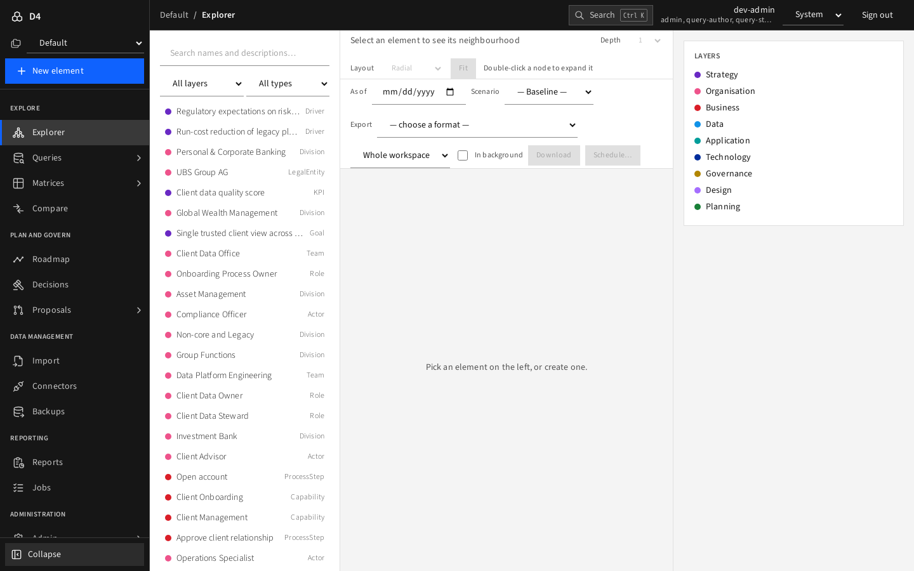
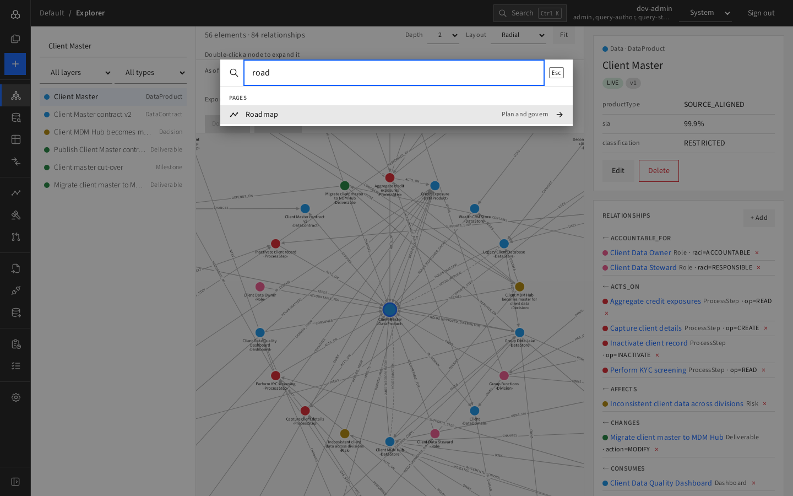
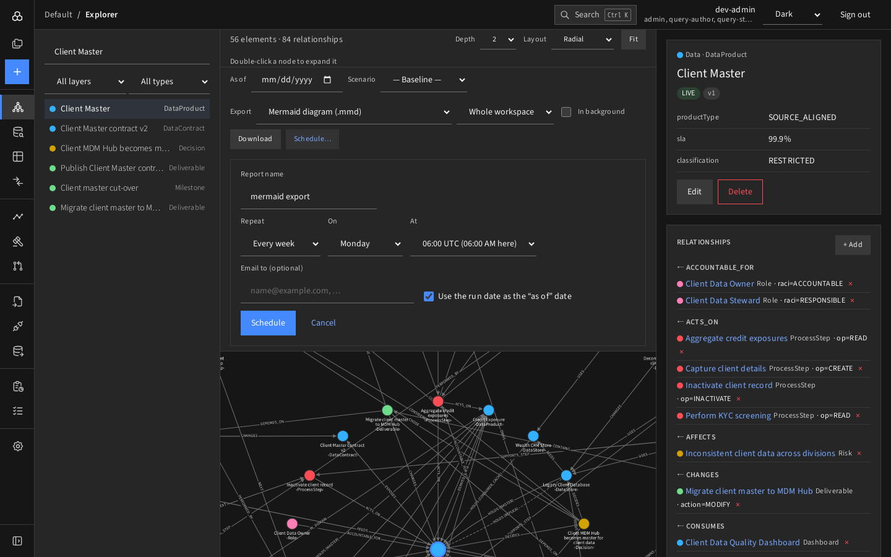
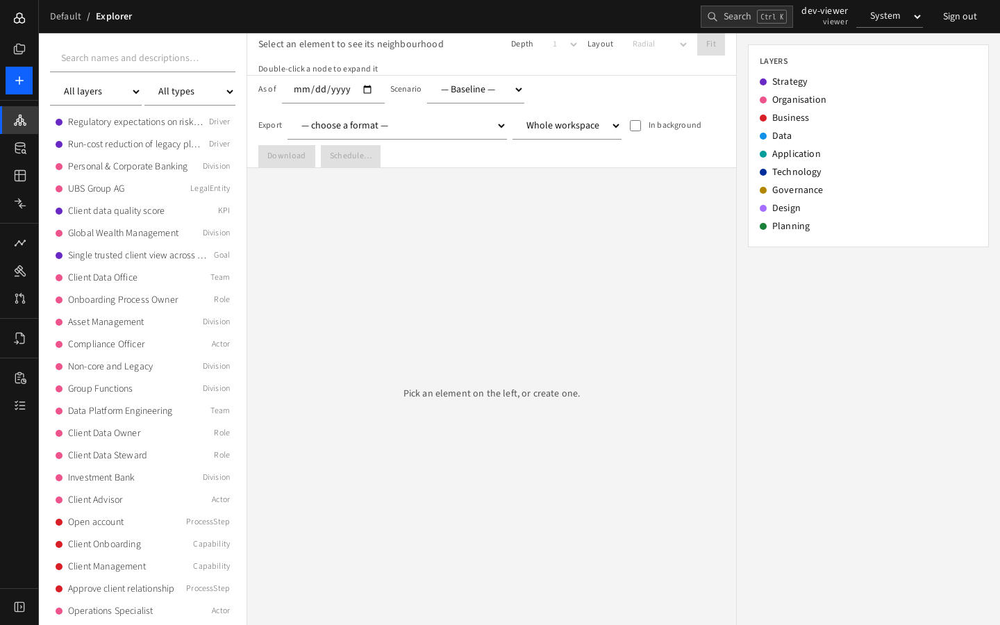

# A tour of the screen

## Left navigation

The narrow **icon rail** on the left is the main menu. Hover an item to see its name and sub-pages; click the toggle at the bottom to expand the rail into full labels.

| Group | Item | What it is for |
|---|---|---|
| Explore | Explorer | Search elements and see them as a graph ([guide](../02-explore/explorer.md)) |
| | Queries | Run, write and review catalog queries ([guide](../02-explore/queries.md)) |
| | Matrices | CRUD-I, capability × application, data-store roles, lifecycle heat-map |
| | Compare | Differences between two dates or scenarios |
| Plan and govern | Roadmap | Gantt chart with dependencies and conflicts |
| | Decisions | Architecture decision log |
| | Proposals | Draft, review and apply batches of changes |
| Data management | Import | Load CSV/Excel files |
| | Connectors* | Sync other systems into D4 |
| | Backups* | Back up and restore a workspace |
| Reporting | Reports | Scheduled exports and pictures |
| | Jobs | Background work and downloads |
| Administration | Admin* | Workspaces, people and roles, webhooks, usage |

\* Admins only. Items you may not use are hidden. Query studio and Stewardship appear under Queries only for authors and stewards.

The blue **+** button at the top of the rail creates a new element.

If you can access more than one workspace, the rail also lets you switch between them.

## Top bar

- **Breadcrumb**: workspace › page › sub-page. Click the workspace name to return to the Explorer.
- **Search** (`Ctrl K`, or `⌘ K` on a Mac): jump to any page, element or query.

  

  Type at least two letters to include elements and queries; use the arrow keys and **Enter**; **Esc** closes.
- **User and roles**: who you are signed in as, and your roles.
- **Theme**: System, Light or Dark. The choice is remembered per browser.

  
- **Sign out**.

## On a narrow screen

The rail turns into a drawer opened by the menu button at the top left.

## What a viewer sees

A viewer has the same pages for reading, but no admin pages, and writes are refused by the server. The only differences you see are the missing Admin, Connectors and Backups items and the query screens you are not entitled to.

