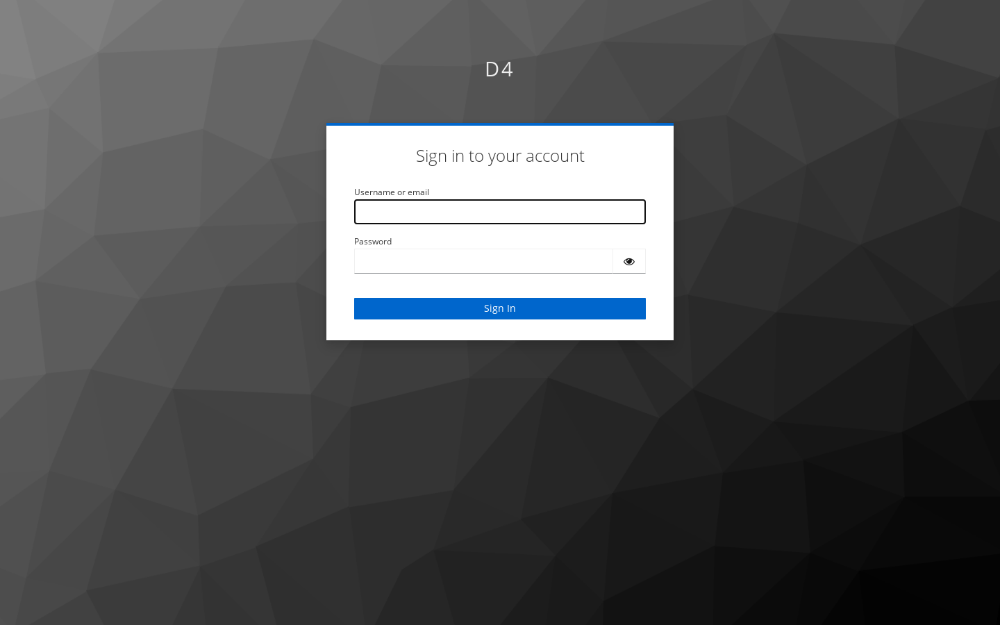

# Signing in

D4 uses your organisation's single sign-on (Keycloak in the local setup).

1. Open the D4 address (locally <http://localhost:5173>).
2. You are sent to the sign-in page. Enter your username and password and press **Sign In**.

   

3. You land in the **Explorer** of your first workspace.

If you opened a deep link (for example to a specific element) before signing in, you are taken to that page after signing in.

## Local development users

In the local stack, all of these have the password `d4-local-dev`:

| User | Roles | Good for |
|---|---|---|
| `dev-admin` | admin, query-author, query-steward | Everything, including administration |
| `dev-viewer` | viewer | Read-only browsing |
| `dev-author` | query-author, viewer | Writing catalog queries |
| `dev-steward` | query-steward, viewer | Reviewing and publishing queries |

## Signing out

Press **Sign out** at the top right. Your single sign-on session may remain active in the browser, so signing in again can be instant.

## If something goes wrong

- "Signing in…" never finishes: reload the page; make sure you are using the exact address configured for D4 (the local stack only accepts port 5173).
- You see "Administration needs the admin role" or menu items are missing: your account lacks a role. See [Roles and access](roles-and-access.md).
