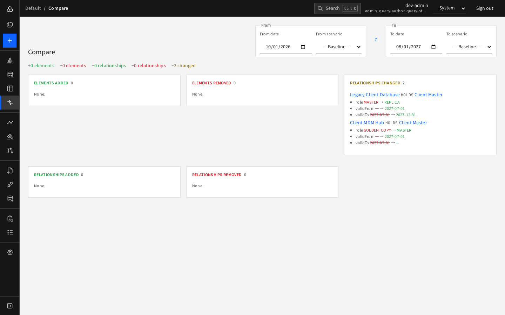

# Compare

**Compare** shows what differs between two views of the model. A view is a date, a scenario, or both.

## How to use it

1. Open **Compare** in the left rail.
2. Set the **From** side (date and scenario) and the **To** side.
3. Read the result. Use the swap button (⇄) between the sides to reverse the direction.

If both sides are the same, the page asks you to pick two different dates or a scenario on one side.

## What you see

A one-line summary, for example "+0 elements −0 elements +0 relationships −0 relationships ~2 changed", then five sections:

| Section | Meaning |
|---|---|
| **Elements added / removed** | Elements present only in the To view / only in the From view |
| **Relationships added / removed** | Same, for relationships |
| **Relationships changed** | Same relationship in both views, with different fields: old value struck through, new value after the arrow |

In the screenshot the legacy client database changes from MASTER to REPLICA and the MDM hub from GOLDEN_COPY to MASTER between October 2026 and August 2027.

Names are links that open the element in the Explorer.

## Sharing

The two sides are kept in the page URL, so you can copy the address to share the exact comparison.
