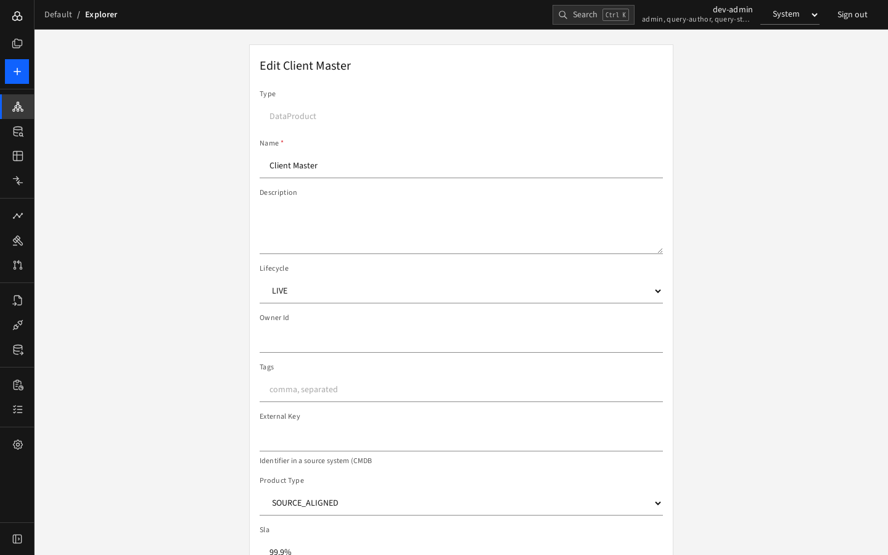

# Creating, editing and deleting

You need the **contributor**, **planner**, **architect** or **admin** role. Without it the server refuses the change and the screen shows why. To change many things together and have them reviewed, use a [change proposal](../03-plan-and-govern/change-proposals.md) instead.

## Create an element

1. Press the blue **+** at the top of the left rail (or open `/w/<workspace>/new`).
2. Choose a **Type**. The form rebuilds itself from the metamodel and a short description of the type appears under the selector.
3. Fill in the fields. Required fields are marked with `*`; **Name** is always required.
4. Optionally set **Valid from** and **Valid to** if the element only exists for a period.
5. Press **Create**.

The browser applies the same validation as the server, so mistakes are flagged before you save. New elements start at lifecycle **IDEA** unless you choose another allowed value.

## Edit an element

Select the element, then press **Edit** in the details pane (or open it from the Roadmap with **Edit dates**).

- The **Lifecycle** list offers **only the moves allowed** from the current state. See [lifecycle](../08-reference/lifecycle.md).
- Type cannot be changed after creation.
- If someone else changed the element while you were editing, you get a **version conflict**. Reload the element, re-apply your change and save again.
- A rule violation (for example a second master store for a data product) is shown with the rule's name and nothing is saved.

## Add a relationship

1. Select the element and press **+ Add** in the **Relationships** card.
2. Choose the **relationship type**. Only types the metamodel allows from this element are offered.
3. Choose the **To** (or **From**) element with the search box and list. Only valid partner types are listed, and you must pick an entry (the first entry "— none selected —" means nothing is chosen).
4. Fill in relationship attributes (for example a `HOLDS` role) and optional **Valid from / to**.
5. Press the add button.

If a **scenario** is selected in the toolbar, the relationship is added to that scenario only, and a note says so.

## Remove a relationship

Press **×** next to it and confirm.

## Delete an element

Press **Delete** and confirm. The element and its relationships disappear from all views. The deletion is a soft delete and is recorded in the event log; an administrator can recover data through [backups](../04-data-management/backups.md) if you deleted by mistake.

## Valid periods

Both elements and relationships can have a validity period `[from, to)`: valid from the first date up to, but not including, the second. Leave a date empty for "no limit". Periods drive the **As of** view, [Compare](compare.md) and the matrices.
