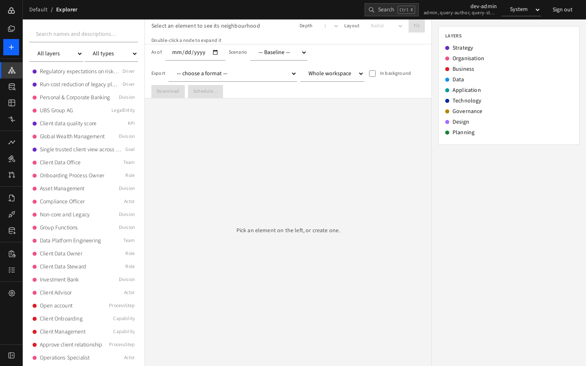
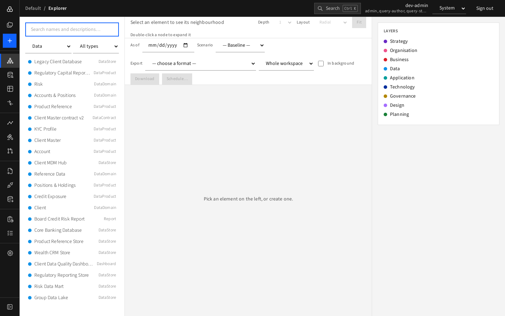
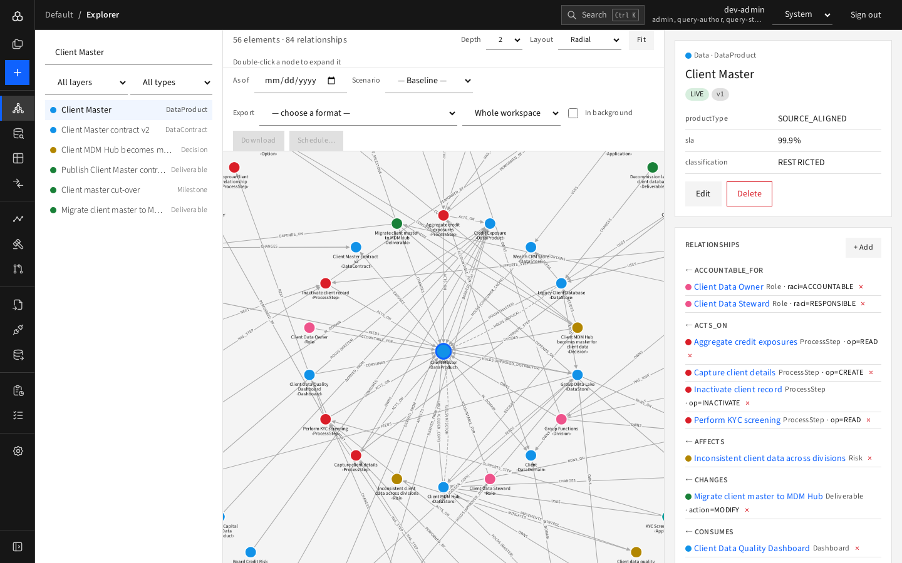
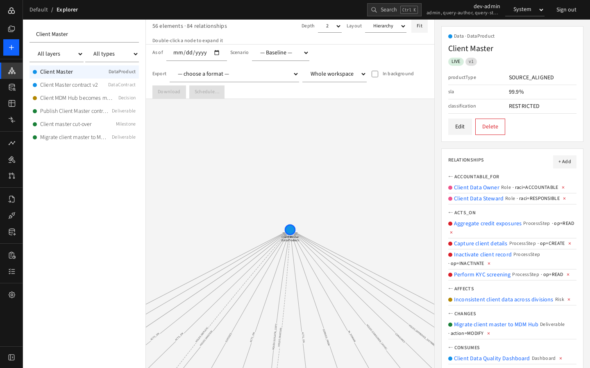

# The Explorer

The Explorer is the home page of a workspace. It has three panes: **find** (left), **see** (centre), **inspect** (right).

With nothing selected, the right pane shows the colour **legend** of the layers.

## Find elements (left pane)

- **Search box**: type part of a name or description. Results are ranked, with exact name matches first. Words are matched even when hyphenated.

  
- **All layers** and **All types**: narrow the list. Pick a layer first and the type list shows only that layer's types.

  
- Scroll to the bottom for **Load more**.
- Click a row to select the element.

## See it in context (centre pane)

Selecting an element loads its **neighbourhood**: the element and everything connected to it.

- Header shows counts: "19 elements · 20 relationships". "truncated" appears if the neighbourhood was too large to show completely.
- **Depth** 1–3: how many hops away to include.

  
- **Layout**:
  - **Radial** (default): the selected element in the middle, rings by distance.
  - **Force**: clustered by connectivity.
  - **Hierarchy**: top-down flow, good for lineage.

  
- **Fit** re-centres and zooms to the whole graph. Large graphs keep a readable zoom, so pan to see the rest.
- Nodes are coloured by layer. Labels show the element's name and type. Lines are labelled with the relationship type and, where useful, its role.
- **Dashed lines** are relationships that are not valid at the moment, for example a planned hand-over.
- **Click** a node to select it; **double-click** to expand it, merging its own neighbours into the picture so you can walk the graph.
- The toolbar below also contains **As of**, **Scenario** ([time and scenarios](time-and-scenarios.md)) and **Export** ([exporting](../04-data-management/export.md)).

## Inspect and change (right pane)

- **Header**: layer · type, name, lifecycle badge, version, and validity dates.
- **Attributes**: the type-specific fields that have values.
- **Edit** and **Delete**: see [editing](editing.md).
- **Relationships**: grouped by direction, "TYPE →" for outgoing and "← TYPE" for incoming. Click a name to move to that element. **× ** removes a relationship. **+ Add** creates one.
- **History**: every change, newest first, with the old and new value of each changed field and a marker for changes that came from an import.

## Deep links

Every selection has its own URL (`/w/<workspace>/e/<element>`), so you can paste it to a colleague. Depth and layout are not part of the link.

## Tips

- Start from a division, a capability or a data product and use depth 2 to see how things hang together.
- Use **Hierarchy** with depth 3 for lineage of a data product.
- Use the [Queries](queries.md) page for questions the Explorer cannot answer visually, such as "orphan elements".
