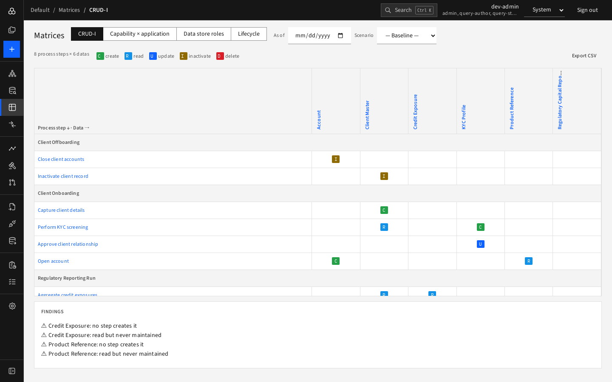
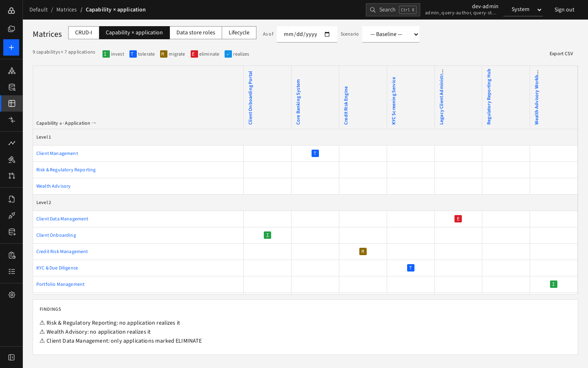
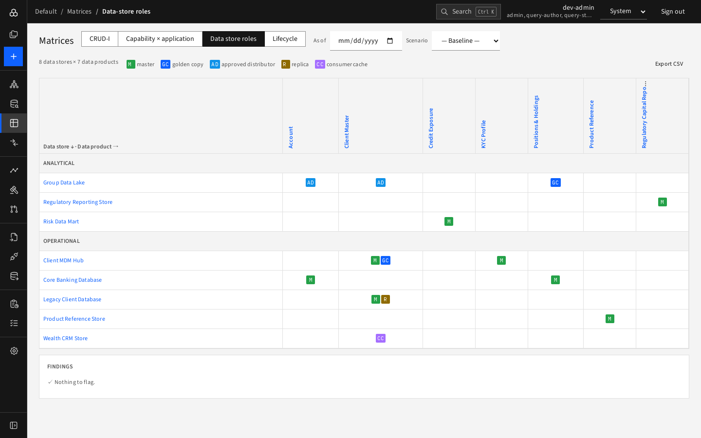
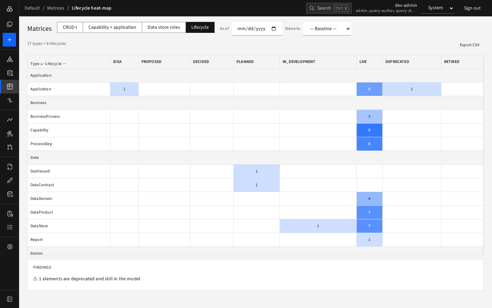

# Matrices

**Matrices** turn the graph into tables that are easy to scan and give **findings** where something looks wrong. Switch between them with the buttons at the top, or from the sub-menu in the rail. Each follows the **As of** date and **Scenario** selectors at the top of the page and has **Export CSV**.

## CRUD-I

Rows are process steps (grouped by process), columns are data products, cells show what the step does to the data: **C**reate, **R**ead, **U**pdate, **I**nactivate, **D**elete.

Findings: data that no step creates, and data that is read but never created or updated.

## Capability × application

Rows are business capabilities by level, columns are applications. A cell shows the application's **TIME class**: **I**nvest, **T**olerate, **M**igrate, **E**liminate; a tick marks an application that realises the capability.

Findings: capabilities that no application realizes, realized by more than two applications (possible overlap), or served only by applications marked ELIMINATE.

## Data-store roles

Rows are data products, columns are data stores, cells show the store's role for the product: MASTER, GOLDEN_COPY, APPROVED_DISTRIBUTOR, REPLICA, CONSUMER_CACHE. Change the As of date to watch roles move over time.

Findings flag data products with no master store, or with more than one master at the same time ("Nothing to flag" means neither happens).

## Lifecycle heat-map

Rows are element types (grouped by layer), columns are the eight lifecycle states, and each cell counts the elements; darker blue means more. Findings flag, for example, deprecated elements that are still in the model.

## Using findings

Findings are a to-do list for data owners. Click a row or column header to open the element and fix it, then reload the matrix.
