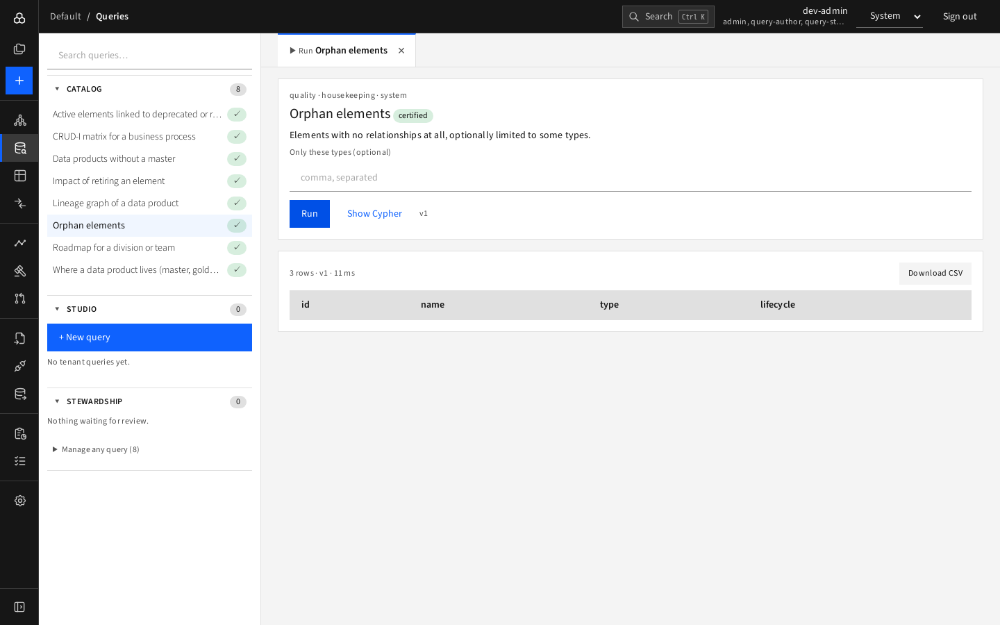
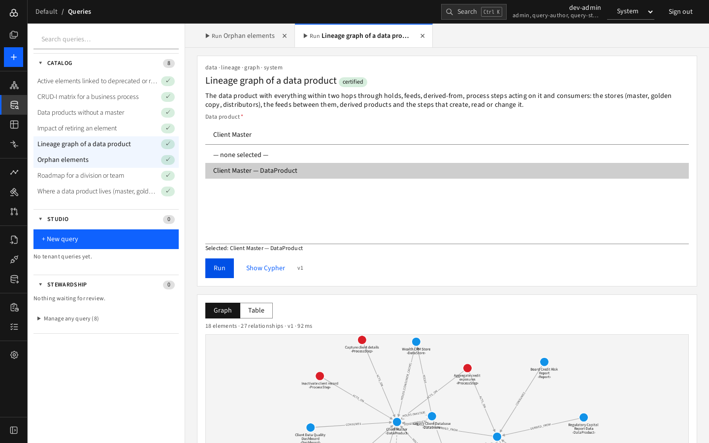
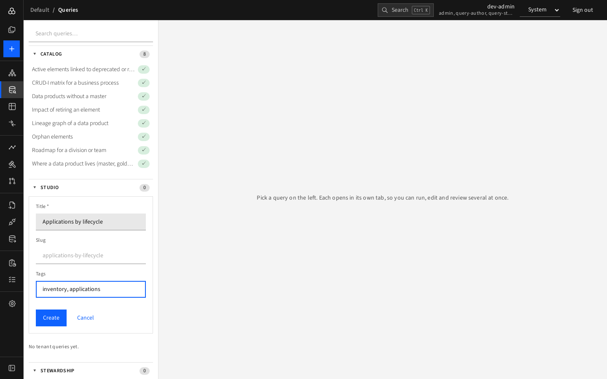
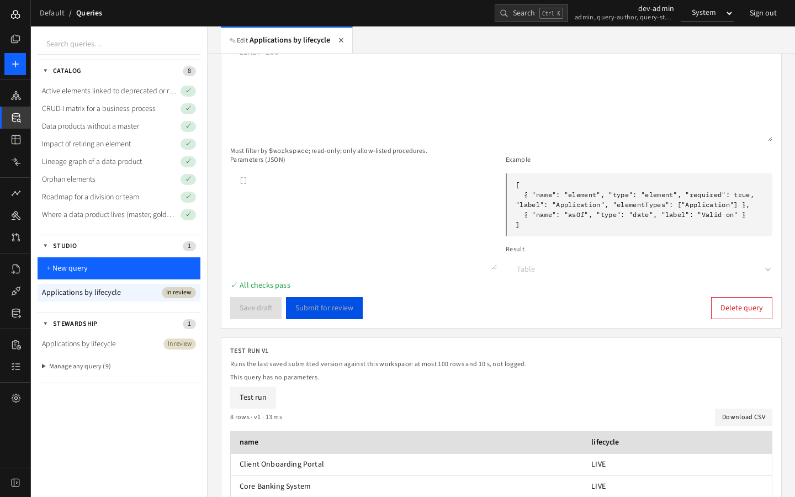
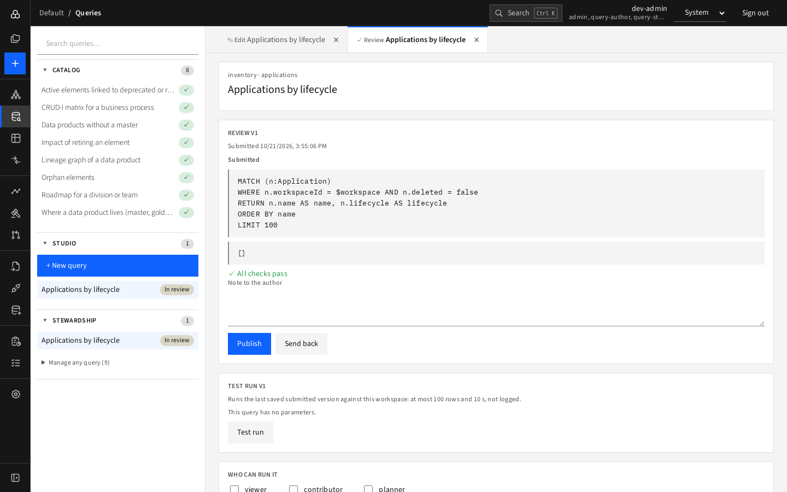
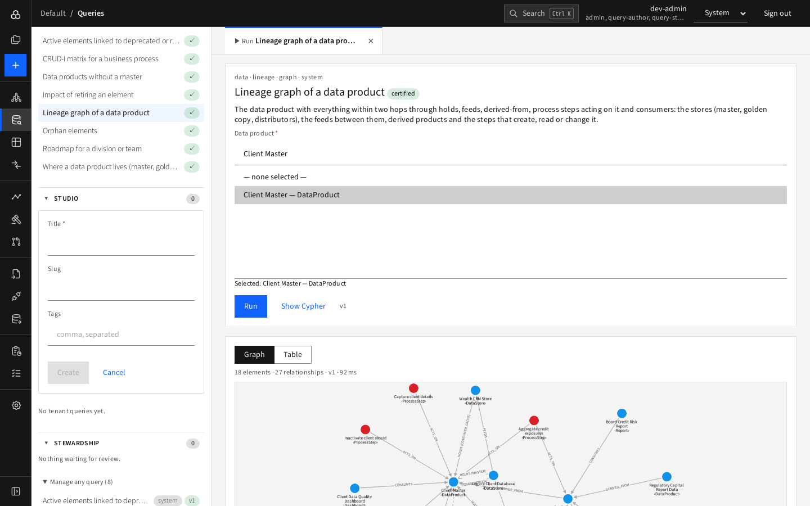

# Queries

The **Queries** page is where you ask questions the visual Explorer cannot answer easily. You never write database code to *read* data: you run **catalog queries** that a *query author* wrote and a *query steward* approved. Anyone with the right role can also write or review queries on the same page.

The left panel is an accordion with three sections and a count on each:

| Section | Who sees it | Purpose |
|---|---|---|
| **Catalog** | Everyone | Queries you may run (a ✓ marks a **certified** query) |
| **Studio** | query-author, admin | Your own queries and **+ New query** |
| **Stewardship** | query-steward, admin | Review queue (count = waiting for review) and "Manage any query" |

Every query you open becomes a **closable tab**, so you can run, edit and review several at once. The open tabs are stored in the page URL, so a reload or a shared link restores them. Use **Search queries…** to filter by title or tag.

## Run a query

1. Click a query in **Catalog**. A **Run** tab opens with its description, tags and parameter form.
2. Fill the parameters:
   - **Element pickers**: type to search, then choose an entry from the list. The first entry "— none selected —" means nothing is chosen; a "Selected:" hint confirms your choice.
   - **Choice lists**, **dates** (an empty date means today for most queries), text, numbers and checkboxes.
   - Required parameters are marked `*`; the form tells you what is missing.
3. Press **Run**. Use **Show Cypher** if you want to see exactly what the query does.
4. Read the result.

### Table or graph results

- **Table**: sortable-looking rows with a row count, version and run time; **Download CSV**; element names link to the Explorer.
- **Graph**: queries declared as graph-shaped show a picture with **Graph / Table** buttons. Double-click a node to open it in the Explorer.

Runs are limited to a maximum number of rows and a time limit, are read-only, and are logged for stewards to see.

### Certified queries shipped with D4

Active elements linked to deprecated or retired ones; CRUD-I matrix for a business process; Data products without a master; Impact of retiring an element; Lineage graph of a data product; Orphan elements; Roadmap for a division or team; Where a data product lives.

## Write a query (query-author)

1. In **Studio** press **+ New query**, enter a **Title**, optionally a **Slug** (suggested for you) and **Tags**, and press **Create**.

   
2. In the **Edit** tab write the **Cypher**. The rules, enforced by checks when you save:
   - it must filter by `$workspace`;
   - it must be read-only (no `CREATE`, `MERGE`, `SET`, `DELETE`, admin commands);
   - it must `RETURN` something and include a `LIMIT`;
   - it may call only allow-listed procedures;
   - every `$parameter` it uses must be declared.
3. Declare **Parameters (JSON)** if the query needs input; the **Example** beside the box shows the format (types include `element`, `date`, `enum`, `string`, `number`, `boolean`). Choose the **Result** shape: Table or Graph.
4. Press **Save draft**. The checks are listed: ✗ errors must be fixed, ! warnings are advice, ✓ means all pass. Saving also validates the query against the database engine.
5. Use **Test run** to try the saved draft (up to 100 rows, 10 seconds, not logged).

   
6. Press **Submit for review**. Submission re-runs the checks. While in review the draft cannot be edited. Statuses show on the list: Draft, In review.

   
7. **Delete query** removes a query that was never published; a published one is archived instead (versions and run history are kept).

## Review and publish (query-steward)

Queries waiting for you are listed under **Stewardship**. Open one for a **Review** tab.

- Compare the submitted Cypher with the currently published one, run a **Test run**, then write an optional **Note to the author** and press **Publish** or **Send back**. Nobody may review their own query, except admins.
- **Who can run it**: tick the roles allowed to run the query and press **Save grants**.
- **Certify** marks a query as trustworthy (the ✓ badge).
- **Version lifecycle**: **Deprecate** a version (it still runs but is flagged), re-publish a deprecated one, or **Retire** it.
- **Recent runs** shows when, which version, status, rows and milliseconds.
- **Manage any query** at the bottom of Stewardship opens any query, including system ones. System queries cannot be edited or removed.

A published version never changes after publication: it is fingerprinted, and the fingerprint is verified before every run. Fixing a published query means submitting a new version.
