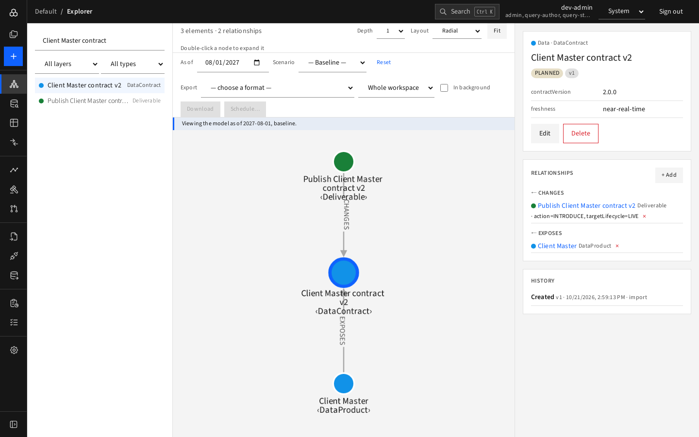

# Time and scenarios

Two controls in the Explorer toolbar change what the whole page shows (list, graph and details), and Matrices and Compare use the same ideas.

## As of

Pick a date in **As of** to see the model as it was or will be on that date. Elements and relationships whose validity period does not include that date are hidden.

A notice above the graph says what you are looking at ("Viewing the model as of 2027-08-01, baseline."). **Reset** returns to today.

Example: a legacy data store holds a client data product as MASTER until 30 June 2027, and a new hub takes over from 1 July 2027. Looking at an earlier date shows the legacy store as master; after the switch, the hub.

## Scenarios

A **scenario** is a named what-if layer on top of the baseline. You can try a different plan without disturbing what everyone else sees.

### Create a scenario

A scenario is an element of type **Scenario** (Planning layer):

1. Press **+** and choose type **Scenario**, name it (for example "Accelerated cut-over") and create it.

### Work inside a scenario

1. In the Explorer toolbar choose it in **Scenario**.
2. Add or change relationships. New relationships carry the scenario's id and are visible only when that scenario is selected.
3. Choose **— Baseline —** to go back. Items belonging to a scenario show a **scenario** badge in the Relationships list.

### See the difference

Use [Compare](compare.md) with baseline on one side and the scenario on the other.

## Combining both

You can combine a date and a scenario: "the baseline plus scenario X, as of 1 Jan 2028". The same pair is respected by [Matrices](matrices.md), exports and scheduled reports.
