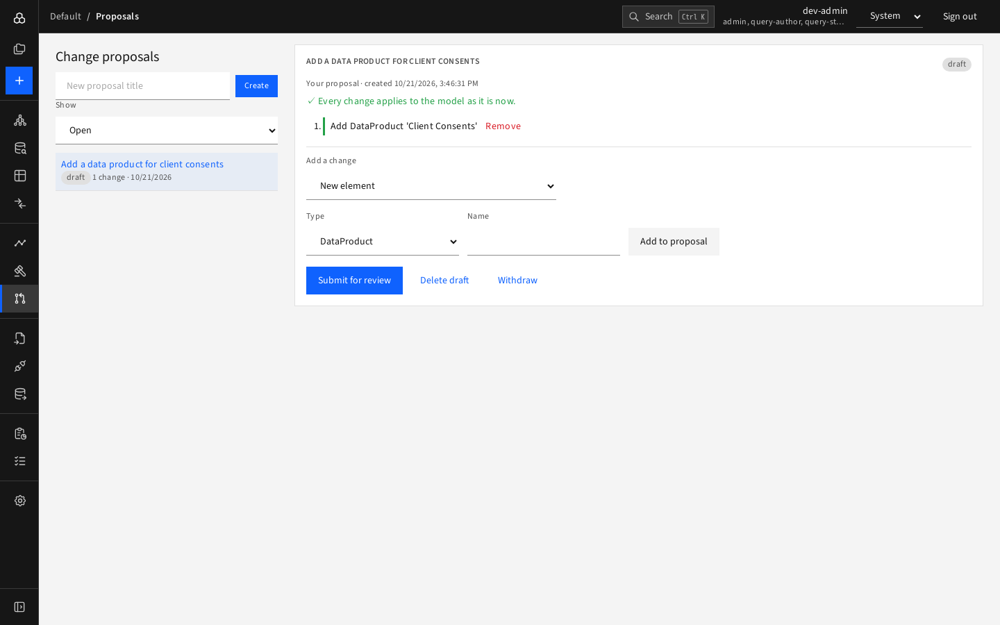
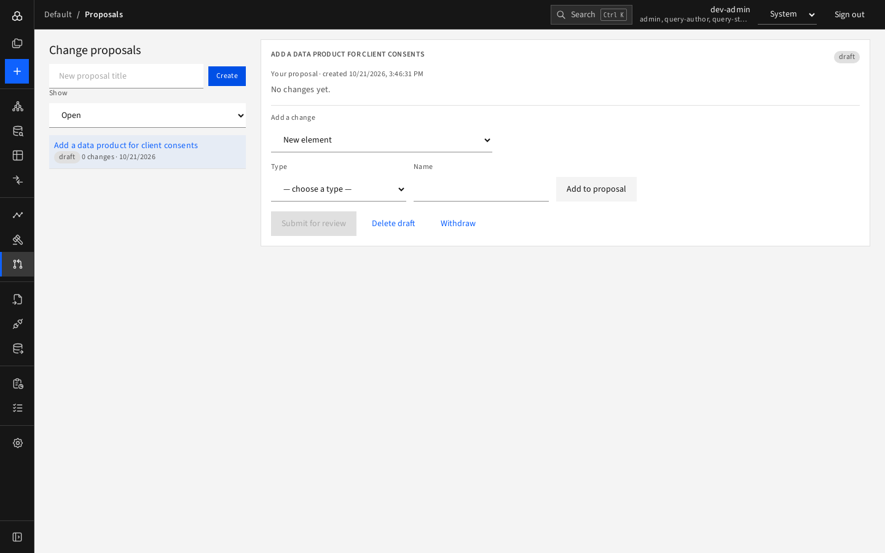

# Change proposals

A **change proposal** is a batch of model changes that is drafted, checked against the live model, reviewed by someone else, and then applied **all at once**. Use it when a change needs a second pair of eyes; for quick edits by yourself, use the [Explorer](../02-explore/editing.md).



## Life of a proposal

```
draft ──submit──▶ submitted ──approve──▶ applied
  ▲                   │  └────reject───▶ rejected
  └──back to draft────┘
draft / submitted ──withdraw──▶ withdrawn
```

The left list can be filtered with **Show**: **Open** (draft and submitted), **Waiting for review** (submitted), **Closed** (applied, rejected, withdrawn) or **All**. The same filters are in the navigation sub-menu.

## Draft a proposal (contributor or higher)

1. Type a title in **New proposal title** and press **Create**.

   
2. Under **Add a change** choose the kind and press **Add to proposal**:

   | Kind | What you give |
   |---|---|
   | **New element** | Type and name. It gets a reference such as `new-1` that later steps can use |
   | **Change an element's attribute** | Element, attribute, new value (an empty value clears it; the current value is shown) |
   | **Connect two elements** | From, relationship type, To, plus relationship attributes. Either end can be an element added earlier in the same proposal, or an existing one |
   | **Delete an element** | The element (its relationships go with it) |
3. Each change appears as a numbered step. **Remove** a step with its link.
4. The page checks every step against the live model and says "✓ Every change applies to the model as it is now" or "✗ A change no longer applies; see the marked step" (for example because someone else edited the element after you chose it). You cannot submit while a step fails.
5. Press **Submit for review**. You may **Delete draft** or **Withdraw** at any time.

Only the author can edit a draft. After submission you can go **Back to draft** to change it, or **Withdraw** it.

## Review a proposal (architect or admin)

You cannot review your own proposal. Open a submitted proposal from **Waiting for review**:

1. Read the steps and the check result.
2. Write a **Review comment** (required when rejecting).
3. Press **Approve and apply** to make all changes in one go, or **Reject**. The author sees your comment.

If the model has moved on and a step no longer applies, **Approve** is disabled; ask the author to reopen and fix the proposal.

## After approval

Status becomes **applied**. Newly created elements get an **open** link in the step list. Changes show in the elements' History like any other edit. A rejected proposal stays on record as closed; create a new proposal to try again.
