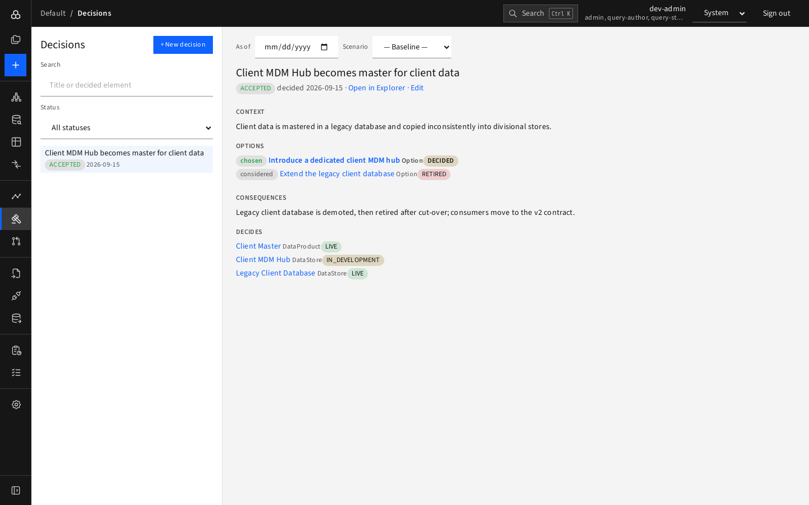

# Decisions

The **Decisions** page is the architecture decision log: what was decided, why, which options were considered, and what it affects.

## Browse

- The list on the left shows decisions newest first, with a status badge and date.
- **Search** by title or by the name of an element a decision affects.
- **Status** filters (Proposed, Accepted, Rejected, Superseded).
- A warning marker on a row means the record has **findings**.

## Read a record

Click a decision to see:

| Section | Content |
|---|---|
| Heading | Title, status and decision date, with links to **Open in Explorer** and **Edit** |
| **Findings** | Gaps to fix: accepted with no option marked chosen, more than one chosen, accepted without a date, superseded but status unchanged, not linked to any element |
| **Context** | Why the decision was needed |
| **Options** | Each option, tagged *chosen* or *considered* (and its outcome, e.g. DECIDED or RETIRED) |
| **Consequences** | What follows from it |
| **Decides** | The elements the decision applies to (with lifecycle) |
| **History** | Supersedes / superseded by |

## Record a decision

Press **New decision**. The editor opens with the type preselected as **Decision**. Fill in name, status, decision date, context and consequences. Then in the Explorer:

1. Add `DECIDES` relationships from the decision to the elements it governs.
2. Add `CHOSE` (to the option taken) and `CONSIDERED` (to alternatives) relationships to option elements.
3. If it replaces an earlier decision, add a `SUPERSEDES` relationship from the new decision to the old one.

Reload the Decisions page; findings disappear as the record is completed.
