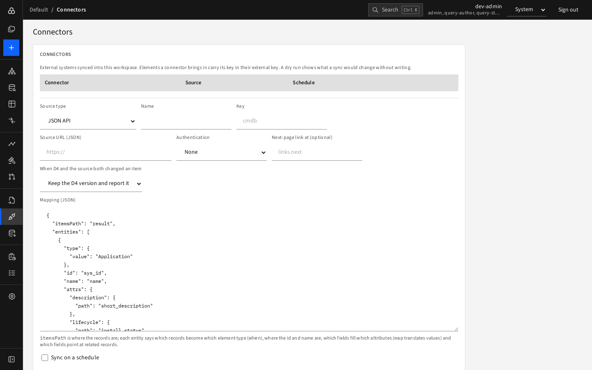

# Connectors (admin)

A **connector** keeps a workspace in step with an external system, such as a CMDB or a Git repository of model files. Elements a connector brings in carry the connector's **key** in their *external key*, so each sync updates the same elements instead of duplicating them.



## Add a connector

Open **Connectors** (admins only) and press **Add connector**.

| Field | Meaning |
|---|---|
| **Source type** | **JSON API** or **Git repository (model-as-code)** |
| **Name**, **Key** | Display name; a short lowercase key such as `cmdb` |
| **Source URL (JSON)** / **Repository URL** | Where to read from |
| **Branch**, **Folder or file** | Git only |
| **Authentication** | None, Bearer token / Access token, or User and password (JSON API). The secret is write-only: it is never shown again |
| **Next-page link at** | For paged JSON APIs, where the link to the next page is (for example `links.next`) |
| **When D4 and the source both changed an item** | **Keep the D4 version and report it** (default) or **Take the source version** |
| **Mapping (JSON)** | JSON API only: tells D4 how records become elements |
| Enabled / schedule | Run manually or on a schedule |

### The mapping

```json
{
  "itemsPath": "result",
  "entities": [
    {
      "type": { "value": "Application" },
      "id": "sys_id",
      "name": "name",
      "attrs": {
        "description": { "path": "short_description" },
        "lifecycle": { "path": "install_status", "map": { "1": "LIVE", "7": "RETIRED" } }
      },
      "relationships": [{ "type": "RUNS_ON", "to": "platform_id" }]
    }
  ]
}
```

`itemsPath` is where the records are in the response; each entity says which records become which element type (`when` can select records), where the id and name are, which fields fill which attributes (`map` translates values), and which fields point at related records.

A Git connector reads D4 model documents (the format of [model export](model-as-code-and-cli.md)); each sync records the commit it read.

## Sync

For each connector the list shows the source, schedule, last run and buttons:

- **Dry run**: reports what a sync would change without writing.
- **Sync now**: runs it. A result bar reports "Wrote: N new, N changed, N unchanged elements; N new relationships" and lists items **needing attention**, such as conflicts where both sides changed.
- **Turn off / Turn on**, **Delete**.

Syncs run as [background jobs](../05-reporting/jobs.md).

## Conflicts

If an element was edited in D4 *and* changed in the source since the last sync, the default is to leave D4's version alone and list the item under "Needs attention". Choose **Take the source version** on the connector if the source system is the authority.
