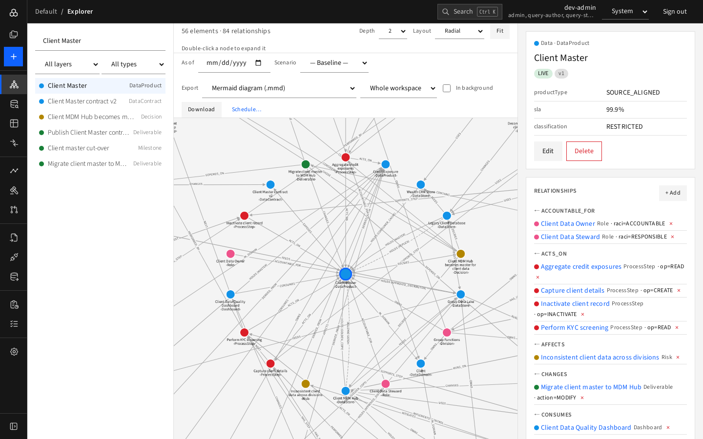

# Exporting

Export lives in the Explorer toolbar (and the Roadmap and Matrices have their own CSV buttons). It respects the **As of** date and **Scenario** that are currently selected.

## Choose

1. **Export** format:

   | Format | Use it for |
   |---|---|
   | Mermaid diagram (.mmd) | Pasting a diagram into documentation |
   | ArchiMate Open Exchange (.xml) | Opening the model in Archi or other ArchiMate tools |
   | Elements (CSV) / Relationships (CSV) | Spreadsheets and analysis |
   | Excel workbook | Elements + relationships; imports back into D4 |
   | Model as code (YAML) | Version control; see [Model as code](model-as-code-and-cli.md) |
   | Cypher script | A re-runnable script to load the model into Neo4j |
   | Picture of this graph — PDF / PNG / SVG | A rendered picture of the graph on screen (needs an element selected) |
2. **This graph** (the selected element and its neighbourhood at the current depth) or **Whole workspace**.
3. Optionally **In background**.

## Run

- **Download** produces the file straight away.
- **In background**, and all pictures (**Start**), run in the worker: the page says "Started. See Jobs" and the file appears on [Jobs](../05-reporting/jobs.md), kept for 30 days.
- **Schedule…** turns the current choice into a recurring [report](../05-reporting/reports.md).

## Other exports

- **Roadmap**: CSV, Mermaid, PDF/PNG/SVG ([Roadmap](../03-plan-and-govern/roadmap.md)).
- **Matrices**: Export CSV.
- **Query results**: Download CSV.
- **Command line**: `d4 export` (see [Model as code and CLI](model-as-code-and-cli.md)).
