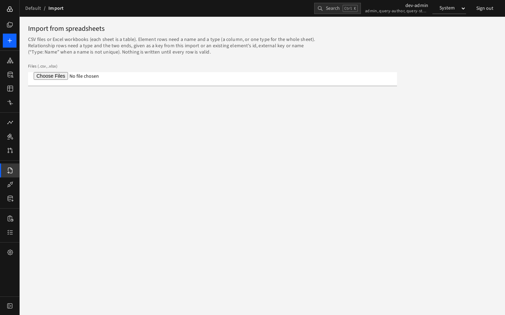

# Importing spreadsheets

**Import** loads elements and relationships from CSV files or Excel workbooks. You need the contributor role or higher.

## Steps

1. Open **Import** and choose files under **Files (.csv, .xlsx)**. You may pick several; each CSV file is one *table*, each sheet of an Excel workbook is one table.
2. D4 reads them and shows a card per table with a **suggested mapping**.

   

   For each table:
   - **Rows are**: **Elements** or **Relationships**.
   - For elements: either **Type for every row** (one type for the whole sheet) or a **Type column**.
   - For every column choose what it **Maps to**: a built-in field (`name`, `type`, `key`, `id`, `externalKey`, `lifecycle`, `description`, `validFrom`, `validTo`, `scenarioId`) or a type attribute, or ignore it. Sample values are shown to help.
   - For relationships the built-in fields are `type`, `from`, `to`, `id`, `validFrom`, `validTo`, `scenarioId`.
3. Press **Check (dry run)**. Nothing is written. You get either:
   - **Ready to import** with counts of new, changed and unchanged elements and relationships, or
   - a list of problems **by row and column** to fix in your file or mapping.

   
4. When the check passes, press **Import**. All rows are written **as one change** — either everything is imported or nothing. Changing the mapping clears the check, so check again.

For large files tick **In background (large files)** and the button becomes **Import in background**; follow it on [Jobs](../05-reporting/jobs.md).

## Identifying the ends of a relationship

The `from` and `to` of a relationship row can be:

- a `key` of an element in the same upload,
- an existing element's **id**, **external key** or **name**,
- `Type: Name` (for example `Application: Core Banking System`) when a name is not unique.

## How rows are matched to existing data

Imports are **idempotent**: an element is matched by id, then external key, then type plus name. Matching rows update the element; new rows create one; **nothing is ever deleted** by an import. Re-importing the same file changes nothing. Imported changes are marked "import" in each element's History.

## Round trip

The Excel workbook produced by [Export](export.md) imports back without any changes.

## Troubleshooting

| Message | Fix |
|---|---|
| Unknown type | The type is not in the workspace's metamodel. Check spelling (PascalCase) |
| Required attribute missing | Map a column to it or fill the cells |
| Value not allowed | The attribute is a list of choices (for example lifecycle); use a listed value |
| Relationship end not found / ambiguous | Use the `Type: Name` form or an id |
| Relationship type not allowed between these types | The metamodel does not permit it |
