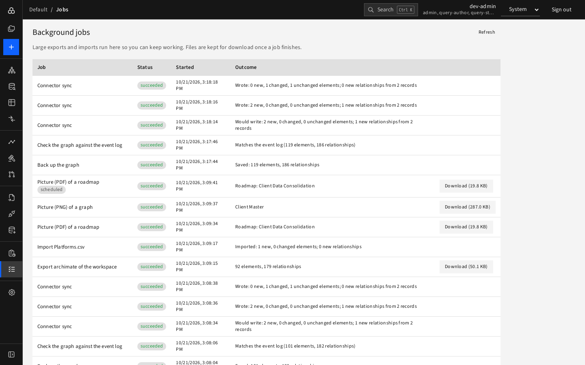

# Background jobs

Long operations run in the background so you can keep working: exports and imports started "In background", pictures (PDF, PNG, SVG), scheduled reports, connector syncs, and backup/restore work.

The **Jobs** page lists your jobs, newest first:

| Column | Meaning |
|---|---|
| **Job** | What it is (with a *scheduled* tag if a schedule started it) |
| **Status** | queued, running (with a progress bar), succeeded, failed; "attempt N" shows retries |
| **Started** | When |
| **Outcome** | A summary such as "Imported: 2 new, 0 changed elements" or an error |
| (last) | **Download (size)** for jobs that produced a file |

Press **Refresh** to update. Jobs are **private to whoever started them**. Files are kept for 30 days; after that the row says "File expired".

If a job failed, the outcome shows why. Retry by starting it again from the original page.
