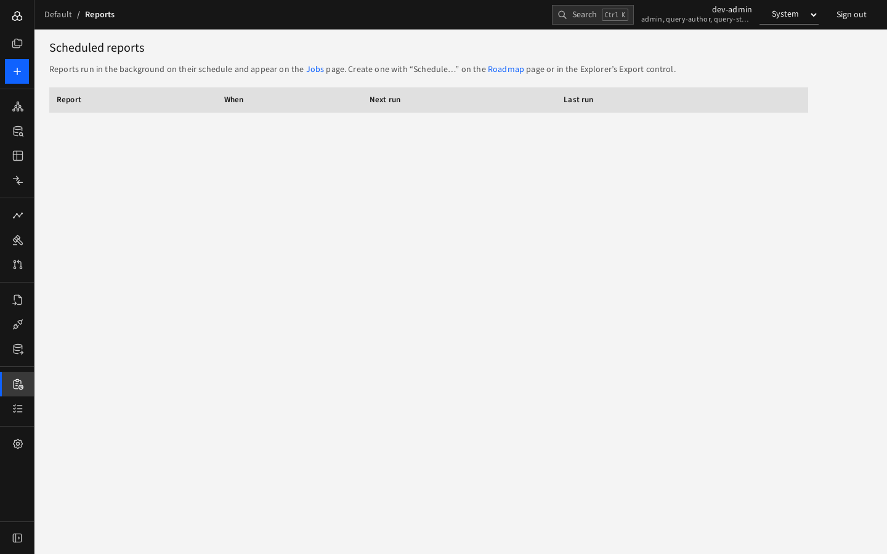
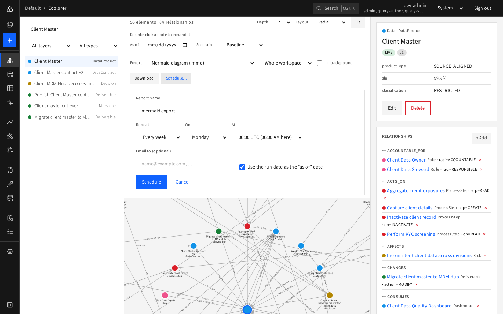

# Scheduled reports

A **scheduled report** is an export or picture that D4 produces for you automatically.

## Create one

Reports are created from where the content is:

- **Roadmap**: press **Schedule…** above the chart.
- **Explorer**: choose a format in **Export** and press **Schedule…**.

Fill in:

| Field | Meaning |
|---|---|
| **Report name** | Shown in the list |
| **Repeat** | Every day, every week, every month |
| **On** | Weekday (weekly) or day of month (monthly) |
| **At** | Hour, in UTC (your local equivalent is shown) |
| **Email to (optional)** | Comma-separated addresses; the file is attached up to 5 MB |
| **Use the run date as the "as of" date** | Each run reflects the model on the day it runs (for roadmaps, "today") |

## Manage reports

Open **Reports**. Each row shows the report, what it produces, schedule, next run, last run and recipients ("Emailed to …" or "Not emailed"). Buttons:

- **Download** the latest file,
- **Run now**,
- change the schedule (**Edit**/cadence), **Pause / Resume**,
- **Delete**.

Each run also appears on [Jobs](jobs.md), marked *scheduled*. Files are kept for **30 days**.

## Good to know

- A schedule **pauses itself**, with the reason shown, if its owner loses access to the workspace.
- Locally, emails are caught by the local mail catcher at <http://localhost:8025> and never leave the machine.
- Reports run as their creator, so they only contain what that person may see.
