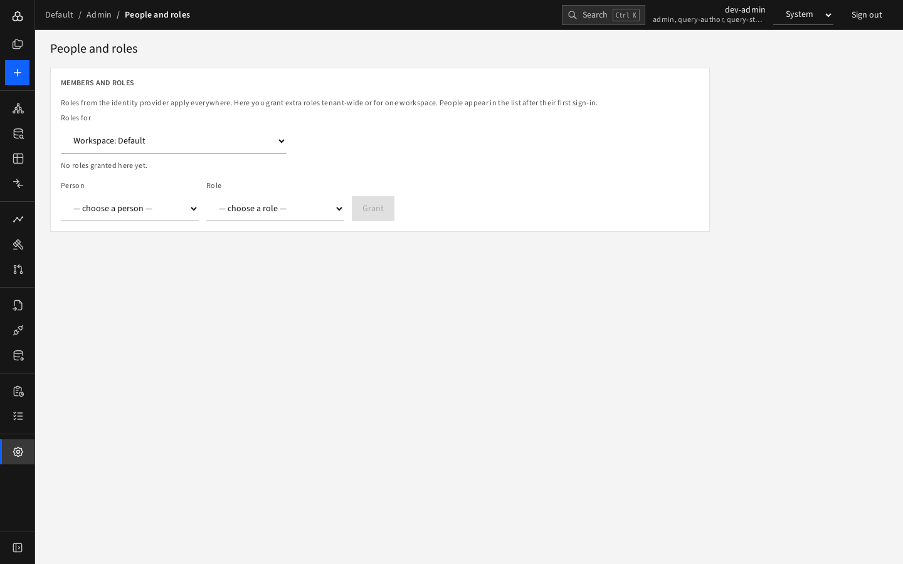

# People and roles

**Admin › People and roles** (admins only).

Roles from the identity provider apply everywhere. Here you grant **extra** roles, either for **the whole tenant** or for **one workspace**. People appear in the list after their first sign-in.

1. Choose **Roles for**: *The whole tenant* or *Workspace: …*.
2. The table shows existing bindings (Who, Role, Granted). **Remove** takes one away. Group bindings carry a *group* badge.
3. To grant, choose a **Person** and a **Role** (viewer, contributor, planner, architect, query-author, query-steward, admin) and press **Grant**.

Changes apply at once. Role removals made in the identity provider reach scheduled reports after the person's next sign-in. For what each role allows, see [Roles and access](../01-getting-started/roles-and-access.md).
