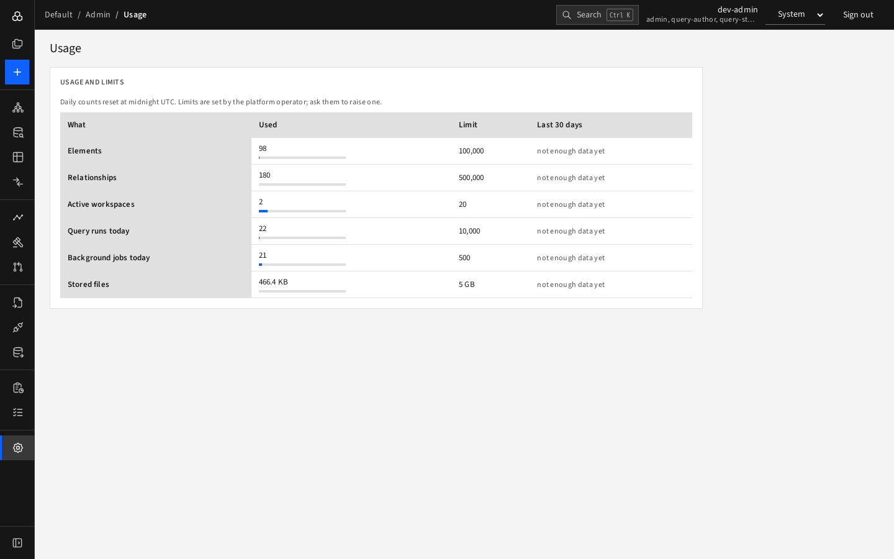

# Usage and limits

**Admin › Usage** shows how much of the organisation's allowance you have used.

| Row | Measures |
|---|---|
| Elements, Relationships | Current totals |
| Active workspaces | Not archived |
| Query runs today, Background jobs today | Reset at midnight UTC |
| Stored files | Exports, pictures and backups |

Each row has a bar for **Used** versus **Limit** (the bar changes colour as you approach the limit) and a 30-day trend once enough days of data exist.

Default limits: 100,000 elements, 500,000 relationships, 20 workspaces, 10,000 query runs a day, 500 jobs a day, 5 GB of files. Limits are set by the platform operator; ask them to raise one. When a limit would be passed, the action is refused with a "quota exceeded" message naming the metric.
