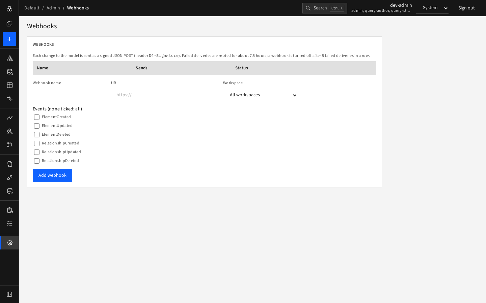

# Webhooks

**Admin › Webhooks** (admins only) sends each model change to another system as a **signed JSON POST**.

## Add a webhook

Fill **Webhook name**, **URL** (https; it must not resolve to a private address), **Workspace** (a single workspace or *All workspaces*), and tick the **event types** to send (none ticked = every event). Press the create button.

D4 then shows the **signing secret once**. Copy it immediately; use it to verify the `D4-Signature` header on each request. If you lose it, delete and recreate the webhook.

## Manage

The list shows name, destination, what it sends, and status (**on** / **off**, with the reason when D4 turned it off). Buttons:

- **Deliveries** (expand) shows When, Event, Result, Attempts, and **Redeliver** for a delivery,
- **Ping** sends a test event,
- **Turn off / on**,
- **Delete**.

## Delivery behaviour

Failed deliveries are retried for about 7.5 hours. A webhook is **turned off automatically after 5 failed deliveries in a row**; fix the receiver and turn it on again.
