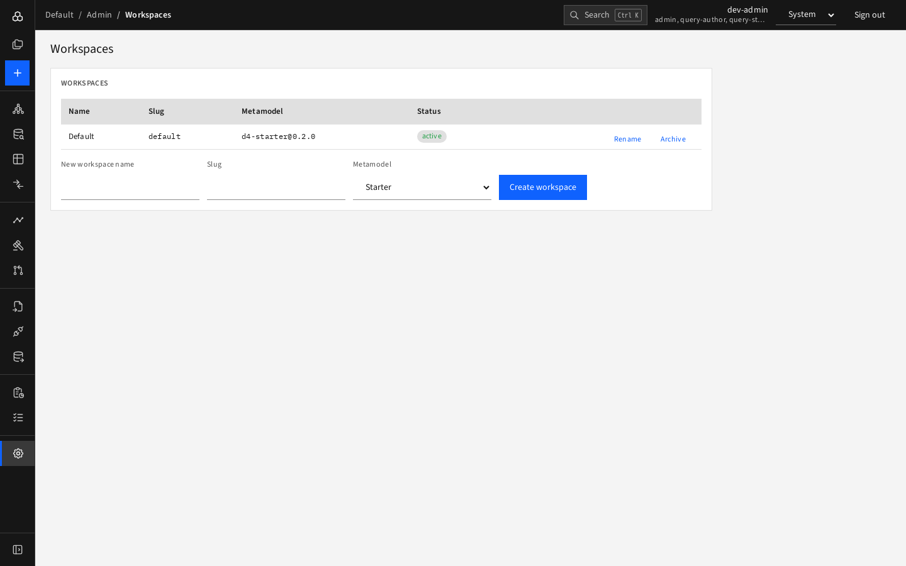

# Workspaces

**Admin › Workspaces** (admins only).

The table lists all workspaces with name, slug, metamodel (`name@version`) and status.

## Create a workspace

Fill the form below the table:

| Field | Notes |
|---|---|
| **New workspace name** | Display name |
| **Slug** | Lowercase letters, digits and dashes; used in URLs and the CLI |
| **Metamodel** | **Starter** (about 125 types) or an industry pack: **Banking** (BIAN landscape, products, regulatory reporting) or **Insurance** (products, coverages, claims, Solvency II / IFRS 17). Choosing a pack shows its description |

Press **Create workspace**. The workspace's database structure is prepared and it appears in the list and the workspace switcher.

## Rename, archive, restore

- **Rename** edits the display name.
- **Archive** hides the workspace from everyone's lists and blocks writes; data is kept.
- **Restore** brings an archived workspace back.

Workspaces are never deleted from this page. The number of active workspaces counts toward the [limit](usage-and-limits.md).

The metamodel of a workspace is fixed at creation; a platform operator upgrades it.
