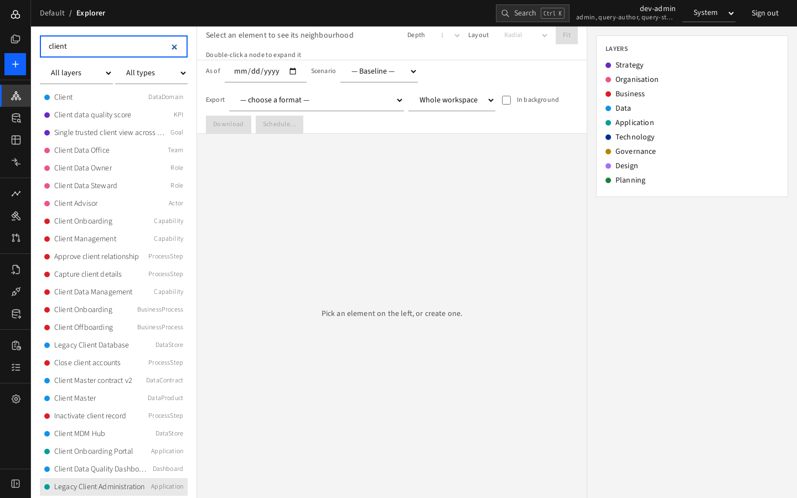
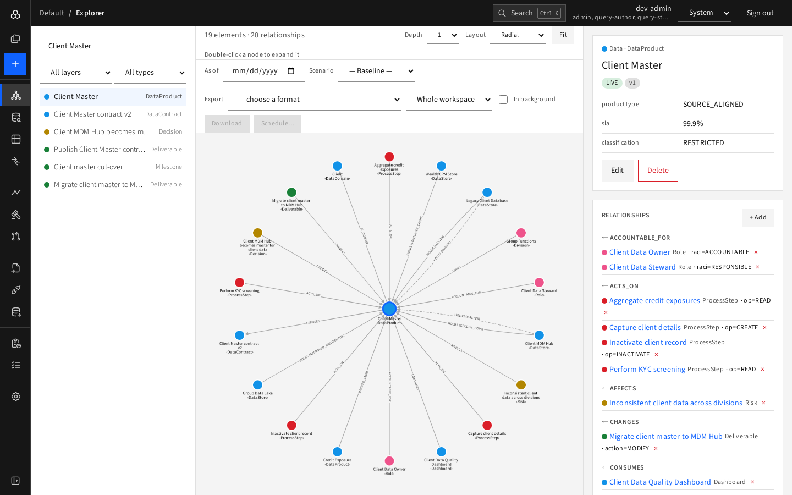

# Journey 1 — Find out where a data product lives

**Who:** anyone (viewer is enough). **Goal:** learn which data store is the master for "Client Master", what else holds it, and who owns it.

1. Sign in ([Signing in](../01-getting-started/signing-in.md)).
2. In the Explorer's search box type `Client Master` and click the exact **Client Master** (DataProduct) row.

   
3. Read the right pane: lifecycle **LIVE**, classification, SLA.
4. In **Relationships**, find the `← HOLDS` group. The `role` of each store tells you MASTER, GOLDEN_COPY, REPLICA…

   
5. Want the picture of lineage? Set **Depth** to 2 and **Layout** to **Hierarchy**.
6. Want it answered formally? Open **Queries › Catalog › Where a data product lives**, pick the product and press **Run**; **Download CSV** for a spreadsheet.
7. Does the answer change next year? Set **As of** to a future date (for example 1 Aug 2027) and see the master move to the new hub.

   

**Result:** you know the master store, copies and owner role, now and in future. Share the page URL with colleagues.
