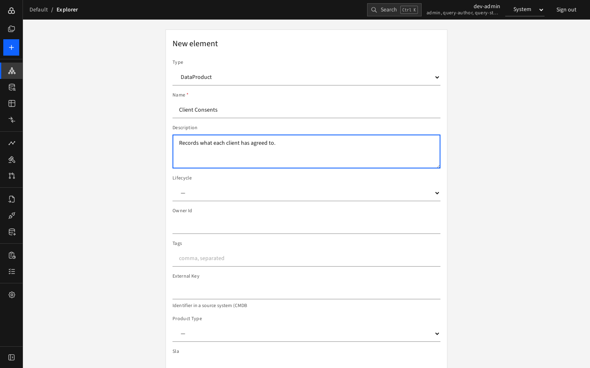
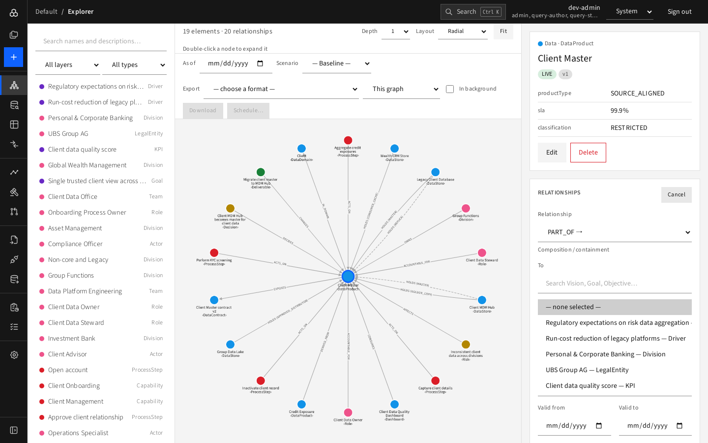

# Journey 2 — Add a new element and connect it

**Who:** contributor, planner, architect or admin. **Goal:** record a new data product, "Client Consents", and show which store masters it.

1. Press the blue **+** in the rail.
2. Choose **Type: DataProduct**, name it **Client Consents**, add a description, set **Lifecycle** and (optionally) valid-from.

   
3. Press **Create**. The Explorer opens the new element.
4. In **Relationships** press **+ Add**, choose `HOLDS`, choose the data store as the partner and set **role = MASTER**.

   
5. Save. If you try to give the product a second master in the same period, the **rule violation** message names the rule and nothing is saved.
6. Check **History** at the bottom: your creation and edits are recorded.
7. Later, move it forward: **Edit**, and pick the next lifecycle value offered (see [lifecycle](../08-reference/lifecycle.md)).

**Tip:** if the change needs approval, do it as a [proposal](03-propose-and-review-a-change.md) instead.
