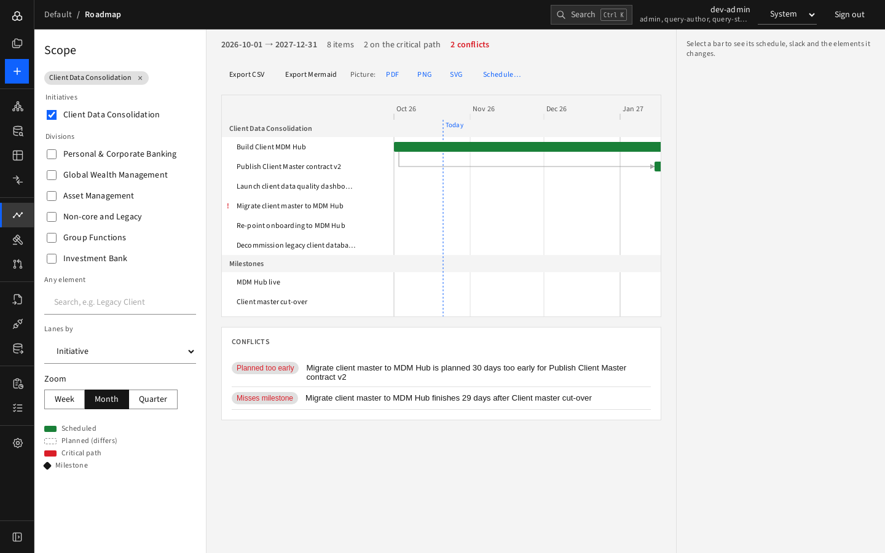
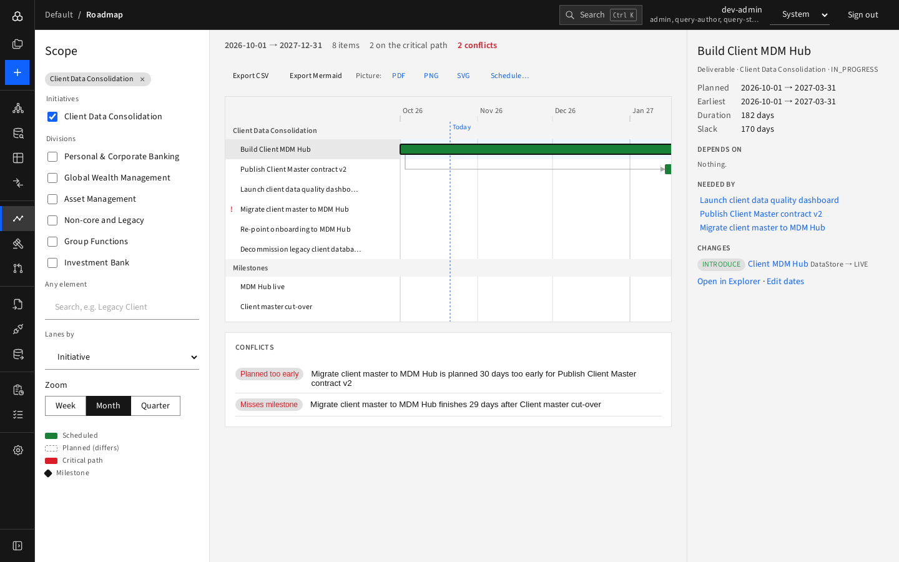

# Journey 4 — Plan a programme and spot schedule conflicts

**Who:** planner. **Goal:** check that the "Client Data Consolidation" initiative's deliverables fit their dependencies and milestones.

1. Open **Roadmap** and tick **Client Data Consolidation** under Initiatives.
2. Set **Lanes by: Initiative** and **Zoom: Month**.

   
3. Read the header ("8 items · 2 on the critical path · 2 conflicts").
4. In **Conflicts** find "Planned too early" and "Misses milestone".
5. Click the bar "Build Client MDM Hub" to see planned vs earliest dates, slack, what it depends on and what needs it.

   
6. Press **Edit dates** and move the planned start or end; return to the Roadmap and confirm the conflict is gone.
7. Share: **Export CSV / Mermaid / PDF**, or **Schedule…** a weekly report ([Journey 8](08-weekly-roadmap-report.md)).

**Result:** a consistent plan with the critical path known.
