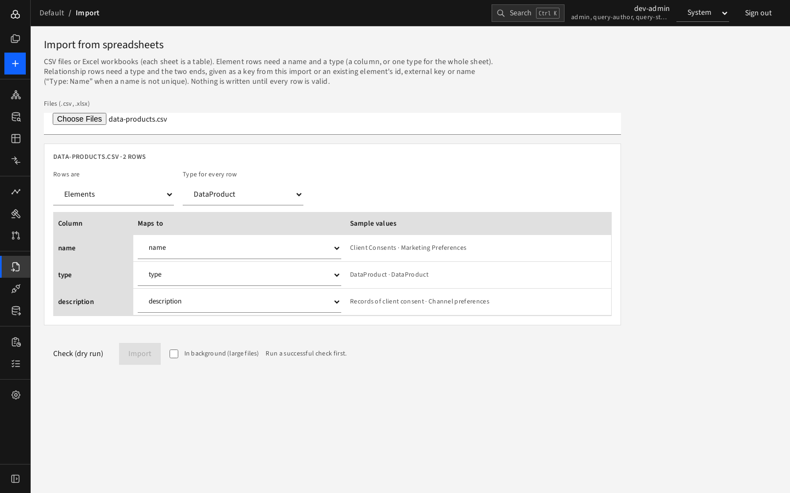
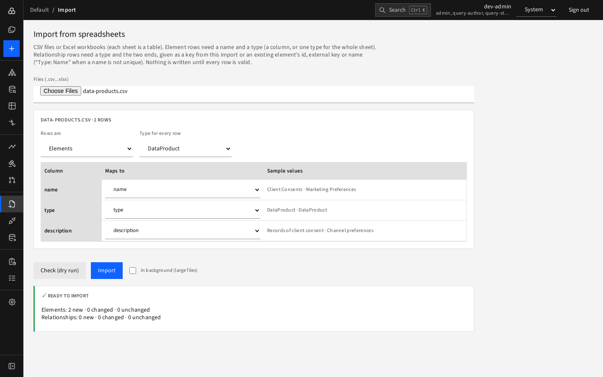

# Journey 7 — Load an existing spreadsheet inventory

**Who:** contributor. **Goal:** bring a list of data products from a spreadsheet into D4.

1. Save the sheet as CSV with a header row, for example:
   ```csv
   name,type,description
   Client Consents,DataProduct,Records of client consent
   Marketing Preferences,DataProduct,Channel preferences
   ```
2. Open **Import** and choose the file.

   
3. Check the suggested mapping (Rows are **Elements**, type **DataProduct**, columns mapped to name/type/description).
4. **Check (dry run)** and fix any listed row/column problems.

   
5. **Import**. Find the new elements with the Explorer search.
6. For links between things, import a second table with Rows are **Relationships** (columns `type`, `from`, `to`), where `from`/`to` are names, ids or external keys.

Re-running the same import is safe: it changes nothing.
