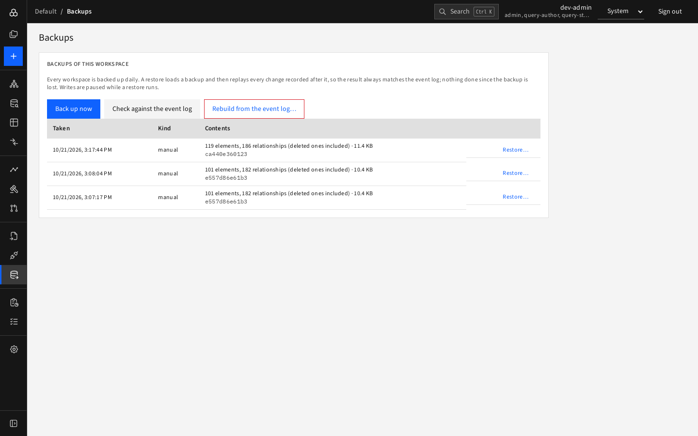

# Journey 11 — Protect and recover a workspace

**Who:** admin.

## Before a risky change

1. **Backups › Back up now**.
2. Press **Check against the event log**: you want "Matches the event log".

   

## Recover

1. A bad bulk change happened. Open **Backups**.
2. Choose the backup from before it and press **Restore…**; type the workspace slug when asked.
3. D4 saves the current graph first, loads the backup and replays recorded changes after it. While it runs the workspace is locked (edits are refused with a clear message).
4. Watch **Jobs**; then check the result in the Explorer.

A restore replays every change recorded after the backup, so it does not undo a bad change by itself: correct the data afterwards (for example with a [proposal](03-propose-and-review-a-change.md)). If the graph itself seems damaged but the log is fine, use **Rebuild from the event log…**.
